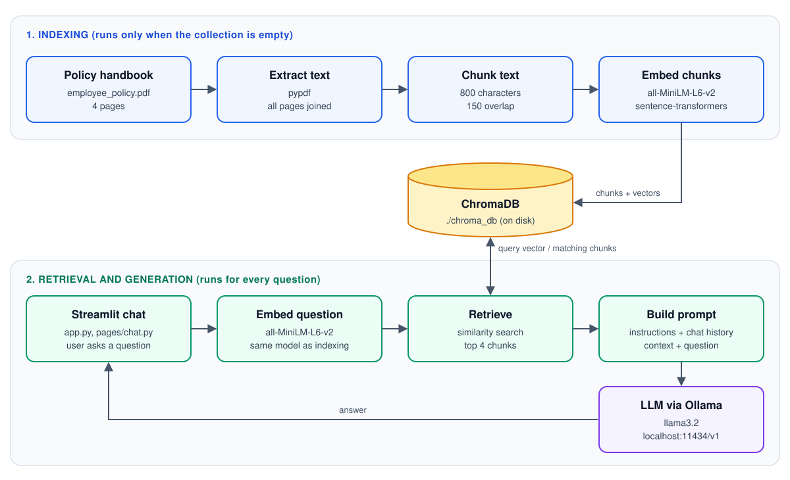

# Northwind HR Assistant

A small retrieval-augmented generation (RAG) app that answers questions about company policies. It searches a sample employee handbook for the most relevant passages and asks a language model to answer using only those passages.

The web chat runs on your machine: embeddings come from `sentence-transformers`, vectors are stored in ChromaDB, and answers are generated by a model served by [Ollama](https://ollama.com).

> The included handbook (`employee_policy.pdf`) is a sample document. All names and figures in it are fictional.

## Architecture



### 1. Indexing

Runs when the app first loads, and only if the `employee_policy` collection is empty.

1. `pypdf` extracts the text from every page of `employee_policy.pdf`.
2. `chunk_text` splits the text into 800-character chunks that overlap by 150 characters.
3. `all-MiniLM-L6-v2` turns each chunk into an embedding.
4. The chunks and embeddings are saved to a persistent ChromaDB collection in `./chroma_db`.

### 2. Retrieval and generation

Runs for every question.

1. The question is embedded with the same model used for indexing.
2. ChromaDB returns the 4 most similar chunks.
3. The retrieved chunks and the question are combined into the new user message.
4. The model receives the system instructions, all earlier questions and answers from the session, and that new message. The instructions tell it to answer only from the context, to say it doesn't know when the answer isn't there, and to reply in a natural tone.
5. The request goes to Ollama through its OpenAI-compatible API, and the answer appears in the chat.
6. The question and answer are added to the session history. The retrieved chunks are not stored, so earlier turns are sent without them.

## Tech stack

| Layer | Tool |
| --- | --- |
| Chat interface | Streamlit |
| PDF text extraction | pypdf |
| Embeddings | sentence-transformers (`all-MiniLM-L6-v2`) |
| Vector store | ChromaDB |
| LLM (web chat) | Ollama (`llama3.2`) |
| LLM (command line) | OpenRouter |
| LLM client | OpenAI Python SDK |

## Project structure

```text
.
├── app.py                 # Streamlit entry point
├── main.py                # Command-line version of the pipeline
├── config/
│   ├── header.py          # Page title, header and chat styling
│   └── rag_config.py      # Chunking, indexing and client setup
├── pages/
│   ├── chat.py            # Chat page: retrieval and generation
│   └── login.py           # Login form (not wired up yet)
├── docs/
│   └── architecture.svg   # Architecture diagram
├── employee_policy.pdf    # Source document
└── requirements.txt
```

## Getting started

### Prerequisites

- Python 3 (developed with 3.14)
- [Ollama](https://ollama.com/download), installed and running
- An internet connection on first run, to download the embedding model

### Installation

```bash
git clone https://github.com/adriandotdev/python-rag-pipeline.git
cd python-rag-pipeline

python3 -m venv .venv
source .venv/bin/activate      # Windows: .venv\Scripts\activate
pip install -r requirements.txt

ollama pull llama3.2
```

### Configuration

Create a `.env` file in the project root:

```env
AI_MODEL=llama3.2
```

| Variable | Used by | Description |
| --- | --- | --- |
| `AI_MODEL` | web chat and command line | Model name. Use an Ollama model for the web chat and an OpenRouter model ID for the command line. |
| `API_KEY` | command line only | OpenRouter API key. The web chat ignores it. |

### Run the web chat

```bash
streamlit run app.py
```

Streamlit prints the local address, usually <http://localhost:8501>. Try asking:

- How long is the probation period?
- What is the notice period after probation?

Run the command from the project root, because the PDF and database paths are relative.

### Run the command-line version

`main.py` uses OpenRouter instead of Ollama. Set `API_KEY` and an OpenRouter model ID in `AI_MODEL`, then run:

```bash
python main.py
```

Type `exit` to quit.

## Using your own document

1. Replace `employee_policy.pdf`, or change the path in `config/rag_config.py` (and in `main.py` if you use it).
2. Delete the `chroma_db/` folder. The app does not detect document changes, so it keeps using the old index until you remove it.
3. Restart the app.

Do the same after changing the chunk size, overlap or embedding model. You may also want to update the page title and caption in `config/header.py`.

## Current limitations

- Retrieval searches with the latest question only. A follow-up such as "What about after that?" may retrieve unrelated chunks, even though the model sees the earlier conversation.
- The full history is sent with every request and is never trimmed, so long chats get slower and can exceed the model's context window.
- History lasts only for the browser session.
- The command-line version (`main.py`) keeps no history and answers each question on its own.
- There is no authentication. `pages/login.py` is a form only and is not part of the app's navigation.
- The web chat's Ollama address (`http://localhost:11434/v1`) is set in `config/rag_config.py`.
- Only one PDF is indexed, and answers don't cite page numbers.
